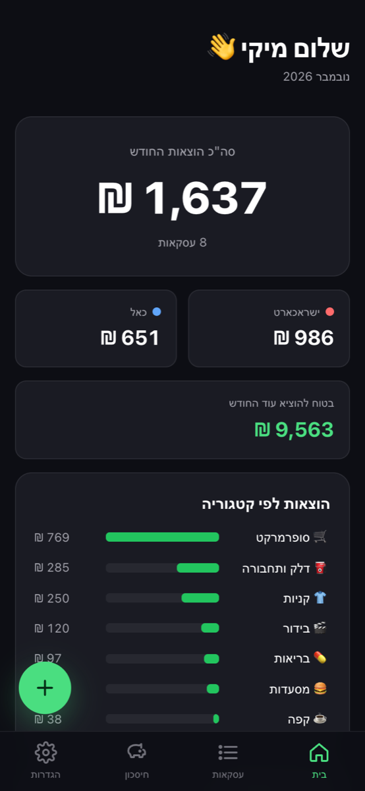
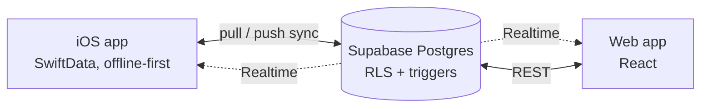

# MyMoney 💳

Track credit-card spending and savings goals with a **native iOS app** (SwiftUI) and a **web app** (React). Both share one Supabase backend and stay in sync in real time.

🌐 **[Open the web app](https://mikelbeizermam.github.io/MyMoney/)**: sign up and use it on your phone or computer<br>
🎨 **[Static design demo](https://mikelbeizermam.github.io/MyMoney/demo/)**: click through the screens without an account<br>
📄 **[Product & technical spec (Hebrew)](docs/SPEC.md)**

<p>
  
  &nbsp;
  
</p>

## Features

| | iOS app | Web app |
|---|:-:|:-:|
| Sign up with email confirmation, sign in, forgot / reset password, change password | ✅ | ✅ |
| Delete account (removes all cloud data) | ✅ | ✅ |
| Dashboard: monthly total, per-card totals, spending by category, recent transactions | ✅ | ✅ |
| Add / edit / delete transactions, filter by card & category | ✅ | ✅ |
| Automatic categorisation of Hebrew & English merchant names (one shared rule set) | ✅ | ✅ |
| Savings goal: "safe to spend this month" | ✅ | ✅ |
| Live updates when the other device changes data (Supabase Realtime) | ✅ | ✅ |
| Works fully offline, syncs when back online | ✅ | — |
| Face ID lock, hidden balances in the app switcher | ✅ | — |
| Auto-capture from Wallet notifications via an iOS Shortcut deep link | ✅ | — |

## Tech stack

| Layer | Technology |
|---|---|
| iOS | Swift, SwiftUI (RTL Hebrew), SwiftData, Swift Charts, LocalAuthentication |
| Web | React 19, TypeScript, Vite, mobile-first CSS (no UI framework) |
| Backend | Supabase: Auth (email + password, PKCE), Postgres, PostgREST, Realtime, Row Level Security |
| Delivery | GitHub Actions → GitHub Pages, XcodeGen + Swift Package Manager |

## Architecture highlights



- **Offline-first sync engine** ([`SyncService.swift`](MyMoney/Services/SyncService.swift)): the app always reads and writes SwiftData. A sync cycle *pulls* server changes since a cursor and then *pushes* dirty rows with a bulk upsert. A Realtime subscription triggers a sync as soon as the web app changes something.
- **Conflict resolution**: last-write-wins on `updated_at`, enforced on the client *and* by a Postgres trigger, so a stale device can never overwrite newer data.
- **Server-side cursor**: `synced_at` is set by the database with `clock_timestamp()`, which makes the cursor independent of device clocks and unique within a bulk write.
- **One data contract, two clients**: both apps write the same rows with client-generated UUIDs, soft deletes (`deleted_at`) and identical category values. The web classifier is **generated from the Swift source** ([`gen-classifier.py`](web/scripts/gen-classifier.py)), so both apps always categorise the same way.
- **Security**: RLS limits every user to their own rows (Realtime included). The `anon` role has no table access. Account deletion is a `security definer` function scoped to `auth.uid()`. Keys are never committed.

## Running locally

### Backend (Supabase)

```bash
supabase link --project-ref <your-project-ref>
supabase db push        # schema, RLS, triggers, realtime, delete-account function
supabase config push    # auth redirect URLs + password policy from supabase/config.toml
```

### iOS app

```bash
cp Config/Config.example.xcconfig Config/Config.xcconfig   # fill SUPABASE_URL / SUPABASE_ANON_KEY
open MyMoney.xcodeproj
```

Requires Xcode 16+ and iOS 17+. If you change `project.yml`, regenerate the project with `xcodegen generate`.

### Web app

```bash
cd web
cp .env.example .env.local   # fill VITE_SUPABASE_URL / VITE_SUPABASE_ANON_KEY
npm install
npm run dev                  # http://localhost:5173/MyMoney/
```

Every push to `main` deploys the site via [`.github/workflows/deploy-web.yml`](.github/workflows/deploy-web.yml). The Supabase URL and publishable key come from the repository variables `SUPABASE_URL` and `SUPABASE_ANON_KEY`.

## Project structure

```
MyMoney/                  iOS app (SwiftUI)
├── RootView.swift        auth routing, deep links, app lock
├── Models/               SwiftData models + Supabase DTOs
├── Services/             AuthManager, SyncService, AppLock, classifiers
└── Views/                Auth, Dashboard, Transactions, Savings, Settings
web/                      Web app (React + TypeScript)
├── src/auth/             auth context + Hebrew error mapping
├── src/lib/              Supabase client, data hook with Realtime, shared types
└── src/pages/            Auth, Dashboard, Transactions, Savings, Settings
supabase/                 migrations + auth config
docs/SPEC.md              Hebrew product & technical spec
```

---

Built by Miki Beizerman.
