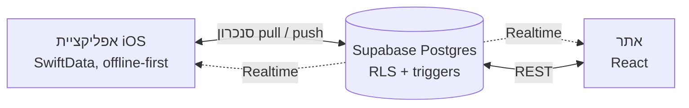

# MyMoney 💳

מעקב אחרי הוצאות האשראי ויעדי החיסכון, ב**אפליקציית iOS** (SwiftUI) וב**אתר** (React). שניהם עובדים מול אותו שרת Supabase ומסתנכרנים בזמן אמת.

🌐 **[לאתר](https://mikelbeizermam.github.io/MyMoney/)**: אפשר להירשם ולהשתמש מהטלפון או מהמחשב<br>
🎨 **[דמו עיצובי](https://mikelbeizermam.github.io/MyMoney/demo/)**: מעבר בין המסכים בלי ליצור חשבון<br>
📄 **[מסמך אפיון](docs/SPEC.md)**: אפיון מוצרי וטכני מלא

<p>
  
  &nbsp;
  
</p>

## פיצ'רים

| פיצ'ר | אפליקציית iOS | אתר |
|---|:-:|:-:|
| הרשמה עם אישור מייל, התחברות, שכחתי סיסמה ושינוי סיסמה | ✅ | ✅ |
| מחיקת חשבון, כולל כל הנתונים בענן | ✅ | ✅ |
| דשבורד: סך ההוצאות החודש, סכום לכל כרטיס, גרף לפי קטגוריה ועסקאות אחרונות | ✅ | ✅ |
| הוספה, עריכה ומחיקה של עסקאות, וסינון לפי כרטיס וקטגוריה | ✅ | ✅ |
| סיווג אוטומטי של שמות בתי עסק בעברית ובאנגלית (אותם כללים בשתי הפלטפורמות) | ✅ | ✅ |
| יעד חיסכון: כמה עוד "בטוח להוציא" החודש | ✅ | ✅ |
| עדכון מיידי כשמשנים נתונים במכשיר השני (Supabase Realtime) | ✅ | ✅ |
| עבודה מלאה בלי אינטרנט, וסנכרון כשהחיבור חוזר | ✅ | — |
| נעילה עם Face ID, והסתרת הסכומים במסך החלפת האפליקציות | ✅ | — |
| קליטה אוטומטית של עסקאות מהתראות Wallet, דרך קיצור דרך (Shortcut) של iOS | ✅ | — |

## טכנולוגיות

| שכבה | טכנולוגיה |
|---|---|
| אפליקציית iOS | Swift, ‏SwiftUI (עברית, מימין לשמאל), ‏SwiftData, ‏Swift Charts, ‏LocalAuthentication |
| אתר | React 19, ‏TypeScript, ‏Vite, ‏CSS שנכתב מאפס בגישת mobile-first, בלי ספריית UI |
| שרת | Supabase: ‏Auth (אימייל וסיסמה, PKCE), ‏Postgres, ‏PostgREST, ‏Realtime, ‏Row Level Security |
| הפצה | GitHub Actions ל-GitHub Pages, ‏XcodeGen ו-Swift Package Manager |

## ארכיטקטורה



- **מנוע סנכרון שעובד גם בלי אינטרנט** ([`SyncService.swift`](MyMoney/Services/SyncService.swift)): האפליקציה תמיד קוראת וכותבת מול SwiftData המקומי. כל סבב סנכרון קודם *מושך* מהשרת את מה שהשתנה מאז הסמן (cursor) האחרון, ואז *דוחף* את השינויים המקומיים ב-upsert מרוכז. האזנה ל-Realtime מפעילה סנכרון ברגע שמשהו משתנה באתר.
- **פתרון התנגשויות**: העריכה האחרונה מנצחת (last-write-wins) לפי `updated_at`. הכלל נאכף גם בצד הלקוח וגם ב-trigger של Postgres, כך שמכשיר עם נתונים ישנים לא יכול לדרוס נתונים חדשים יותר.
- **סמן מבוסס זמן שרת**: את `synced_at` קובע מסד הנתונים עם `clock_timestamp()`. כך הסמן לא תלוי בשעון של המכשיר, וכל שורה מקבלת ערך ייחודי גם כשנכתבות הרבה שורות בבת אחת.
- **שני לקוחות, חוזה נתונים אחד**: האתר והאפליקציה כותבים את אותן שורות בדיוק: מזהה UUID שנוצר אצל הלקוח, מחיקה רכה (`deleted_at`) וערכי קטגוריה זהים. כללי הסיווג של האתר **נוצרים אוטומטית מקוד ה-Swift** ([`gen-classifier.py`](web/scripts/gen-classifier.py)), כך ששתי הפלטפורמות תמיד מסווגות אותו דבר.
- **אבטחה**: ‏RLS מגביל כל משתמש לשורות שלו, כולל בעדכוני Realtime. למשתמש לא מחובר (`anon`) אין גישה לטבלאות. מחיקת חשבון מתבצעת בפונקציה מסוג `security definer` שפועלת רק על `auth.uid()`. מפתחות לא נכנסים לריפו.

## הרצה מקומית

### שרת (Supabase)

```bash
supabase link --project-ref <your-project-ref>
supabase db push        # טבלאות, RLS, triggers, Realtime ופונקציית מחיקת החשבון
supabase config push    # כתובות חזרה למיילים ומדיניות סיסמה מתוך supabase/config.toml
```

### אפליקציית iOS

```bash
cp Config/Config.example.xcconfig Config/Config.xcconfig   # למלא SUPABASE_URL ו-SUPABASE_ANON_KEY
open MyMoney.xcodeproj
```

דרוש Xcode 16 ומעלה, ו-iOS 17 ומעלה. אחרי שינוי ב-`project.yml` צריך ליצור מחדש את הפרויקט עם `xcodegen generate`.

### אתר

```bash
cd web
cp .env.example .env.local   # למלא VITE_SUPABASE_URL ו-VITE_SUPABASE_ANON_KEY
npm install
npm run dev                  # http://localhost:5173/MyMoney/
```

כל push ל-`main` מעלה גרסה חדשה של האתר דרך [`.github/workflows/deploy-web.yml`](.github/workflows/deploy-web.yml). הכתובת והמפתח הציבורי של Supabase מגיעים ממשתני הריפו `SUPABASE_URL` ו-`SUPABASE_ANON_KEY`.

## מבנה הפרויקט

```
MyMoney/                  אפליקציית iOS (SwiftUI)
├── RootView.swift        ניתוב לפי התחברות, קישורים עמוקים ונעילה
├── Models/               מודלים של SwiftData ו-DTO של Supabase
├── Services/             AuthManager, SyncService, AppLock ומסווגים
└── Views/                התחברות, דשבורד, עסקאות, חיסכון והגדרות
web/                      האתר (React + TypeScript)
├── src/auth/             ניהול התחברות ותרגום שגיאות לעברית
├── src/lib/              חיבור ל-Supabase, טעינת נתונים עם Realtime וטיפוסים משותפים
└── src/pages/            התחברות, דשבורד, עסקאות, חיסכון והגדרות
supabase/                 מיגרציות והגדרות התחברות
docs/SPEC.md              מסמך אפיון מוצרי וטכני
```

---

נבנה על ידי מיקי בייזרמן.
