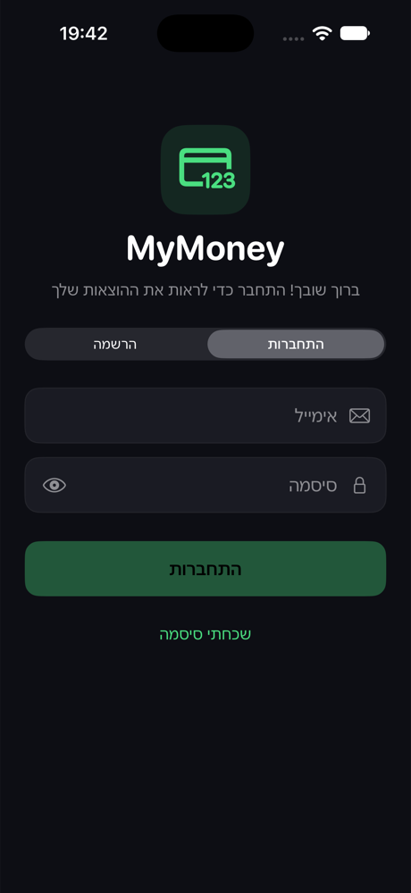
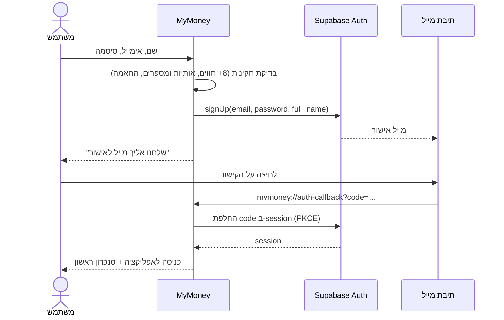
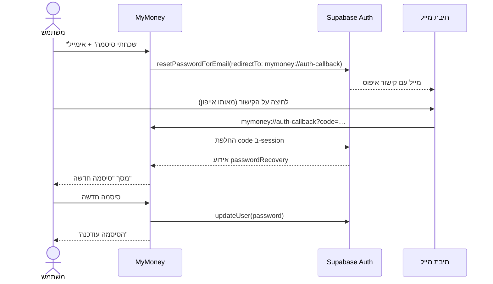
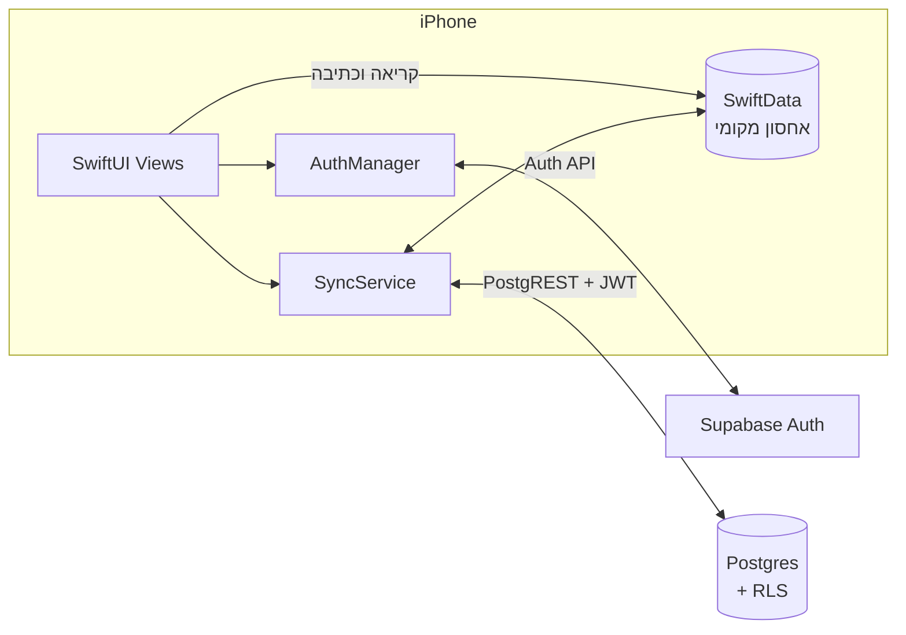

# MyMoney – מסמך אפיון

| | |
|---|---|
| **מוצר** | MyMoney – אפליקציית iOS למעקב הוצאות אשראי ויעדי חיסכון |
| **פלטפורמה** | iPhone, ‏iOS 17 ומעלה |
| **טכנולוגיות** | Swift, ‏SwiftUI, ‏SwiftData, ‏Swift Charts, ‏Supabase (Auth + Postgres) |
| **גרסה** | 1.1 – הוספת חשבונות משתמש וסנכרון לענן |
| **מחבר** | מיקי בייזרמן |

---

## 1. רקע ומטרה

רוב האנשים לא יודעים כמה הם הוציאו החודש עד שמגיע דף החיוב של האשראי. MyMoney מרכזת את העסקאות משני כרטיסי האשראי (ישראכארט וכאל), מסווגת אותן אוטומטית לקטגוריות, ומראה בכל רגע כמה עוד **בטוח להוציא** החודש בלי לפגוע ביעד החיסכון.

**מטרות גרסה 1.1:**
1. כל משתמש מתחבר לחשבון אישי עם אימייל וסיסמה.
2. המשתמש יכול לאפס סיסמה שנשכחה בעצמו, דרך המייל.
3. הנתונים נשמרים בענן (Supabase) ומסונכרנים בין מכשירים, בלי לוותר על עבודה מלאה גם ללא אינטרנט.

## 2. קהל יעד

- צעירים ומשפחות בישראל שמשלמים בעיקר באשראי ורוצים שליטה על התקציב החודשי.
- משתמשים שמחזיקים יותר ממכשיר אחד, או מחליפים טלפון, ולא רוצים לאבד היסטוריה.

## 3. תכולה

### 3.1 פיצ'רים קיימים (גרסה 1.0)

| פיצ'ר | תיאור |
|---|---|
| דשבורד | סך ההוצאות החודש, גרף עמודות לפי קטגוריה (Swift Charts) ועסקאות אחרונות. |
| רשימת עסקאות | סינון לפי כרטיס ולפי קטגוריה, מחיקה בהחלקה. |
| הוספת עסקה ידנית | סכום, בית עסק, תאריך, כרטיס וקטגוריה. |
| סיווג אוטומטי | `CategoryClassifier` מסווג בית עסק לקטגוריה לפי מילות מפתח בעברית ובאנגלית. |
| קליטה אוטומטית מ-Shortcuts | אוטומציה ב-iOS פותחת את הקישור `mymoney://add?amount=…&merchant=…&card=…` כשמגיעה התראה מ-Wallet. |
| יעד חיסכון | הכנסה חודשית ואחוז חיסכון. האפליקציה מחשבת את התקציב להוצאות ואת הסכום שעוד "בטוח להוציא". |

### 3.2 פיצ'רים חדשים (גרסה 1.1)

| פיצ'ר | תיאור |
|---|---|
| הרשמה | שם מלא, אימייל, סיסמה ואימות סיסמה. נשלח מייל לאישור החשבון. |
| התחברות | אימייל וסיסמה. החיבור נשמר, וכניסה חוזרת לאפליקציה לא דורשת התחברות מחדש. |
| שכחתי סיסמה | שליחת קישור איפוס למייל. הקישור פותח את האפליקציה ישירות במסך "סיסמה חדשה". |
| שינוי סיסמה | ממסך ההגדרות, למשתמש מחובר. |
| סנכרון לענן | כל שינוי נשמר מקומית ונשלח ל-Supabase. נתונים ממכשירים אחרים מתקבלים אוטומטית. |
| מצב סנכרון | בהגדרות מוצגים סטטוס (מסונכרן / מסנכרן / נכשל), זמן הסנכרון האחרון, וכפתור "סנכרן עכשיו". |
| התנתקות | לפני היציאה מתבצע ניסיון סנכרון, ואז הנתונים נמחקים מהמכשיר. אם יש שינויים שלא סונכרנו, המשתמש מקבל אזהרה. |

### 3.3 מחוץ לתכולה (בשלב זה)

- התחברות עם Apple או Google.
- שיתוף תקציב בין כמה משתמשים, כמו בני זוג.
- סנכרון בזמן אמת (Realtime). כרגע הסנכרון מתבצע בפתיחת האפליקציה ואחרי כל שינוי.
- גרסת Web או Android.

## 4. מסכים

### 4.1 מסך התחברות / הרשמה

- בורר עליון עם שתי לשוניות: **התחברות** ו**הרשמה**.
- **התחברות:** אימייל, סיסמה (עם כפתור הצגה/הסתרה), כפתור "התחברות" וקישור "שכחתי סיסמה".
- **הרשמה:** שם מלא, אימייל, סיסמה, אימות סיסמה, והסבר על דרישות הסיסמה.
- הכפתור הראשי לא פעיל עד שהשדות תקינים: אימייל בפורמט תקין וסיסמה שאינה ריקה.
- בזמן שליחה מוצג מחוון טעינה בתוך הכפתור.
- שגיאות מוצגות בעברית בבאנר אדום. הודעות הצלחה מוצגות בבאנר ירוק.

### 4.2 מסך "שכחתי סיסמה"

- נפתח כגיליון (sheet) מעל מסך ההתחברות. האימייל שכבר הוקלד מועבר אליו.
- אחרי השליחה מוצגת הודעה ניטרלית: "אם קיים חשבון עם האימייל הזה, נשלח אליו קישור". ההודעה זהה גם אם אין חשבון כזה, כדי לא לחשוף אילו כתובות רשומות במערכת.

### 4.3 מסך "סיסמה חדשה"

- נפתח אוטומטית כשהמשתמש לוחץ על קישור האיפוס במייל.
- שני שדות: סיסמה חדשה ואימות. אחרי השמירה מוצג מסך הצלחה.
- במצב איפוס אי אפשר לסגור את המסך בהחלקה. כך המשתמש לא נשאר מחובר בלי שבחר סיסמה.
- אותו מסך משמש גם ל"שינוי סיסמה" מתוך ההגדרות.

### 4.4 הגדרות – אזור חשבון

- כרטיס פרופיל: אות ראשונה של השם, השם המלא והאימייל.
- "שינוי סיסמה", סטטוס הסנכרון, "סנכרן עכשיו" ו"התנתקות" (עם חלון אישור).

## 5. תהליכים (User Flows)

### 5.1 הרשמה ואישור מייל

### 5.2 איפוס סיסמה

> **הערה:** Supabase משתמשת ב-PKCE, ולכן צריך לפתוח את קישור האיפוס באותו מכשיר שממנו נשלחה הבקשה. מכשיר אחר לא מחזיק את ה-code verifier.

### 5.3 נתונים שנוצרו לפני ההתחברות

משתמש שהשתמש באפליקציה לפני גרסה 1.1 לא מאבד את הנתונים שלו. בהתחברות הראשונה, כל עסקה ויעד חיסכון שאין להם בעלים משויכים למשתמש המחובר ומועלים לענן.

### 5.4 עסקה מ-Shortcuts כשהמשתמש מנותק

אם הקישור `mymoney://add` מגיע כשאין משתמש מחובר, העסקה נשמרת בצד ונוספת מיד אחרי ההתחברות.

## 6. ארכיטקטורה

| רכיב | אחריות |
|---|---|
| `AuthManager` | מאזין לשינויי מצב ההתחברות (`authStateChanges`), מבצע התחברות, הרשמה, איפוס, עדכון סיסמה והתנתקות, ומתרגם שגיאות להודעות בעברית. |
| `SyncService` | מנוע הסנכרון. מושך שינויים מהענן, דוחף שינויים מקומיים, מטפל בהתנגשויות ומציג סטטוס. |
| `RootView` | מחליט מה מוצג (טעינה / התחברות / האפליקציה), מחבר בין ההתחברות לסנכרון, ומטפל בכל קישורי `mymoney://`. |
| `SupabaseService` | יוצר את ה-client מתוך הגדרות שמגיעות מ-`Config.xcconfig`. המפתחות לא נכנסים לקוד. |

### עקרון Offline-First

האפליקציה עובדת קודם כל מול SwiftData המקומי, ולכן הממשק מהיר ועובד גם בטיסה. הענן הוא העתק מסונכרן, לא תנאי לשימוש.

## 7. מודל נתונים

### 7.1 מקומי (SwiftData)

לכל מודל נוספו שדות סנכרון. לכל השדות האלה יש ערכי ברירת מחדל, כך ש-SwiftData מעדכן מסד נתונים קיים (lightweight migration) בלי לאבד מידע.

| שדה | סוג | משמעות |
|---|---|---|
| `userId` | `UUID?` | הבעלים. `nil` מסמן נתונים שנוצרו לפני התחברות. |
| `updatedAt` | `Date` | זמן העריכה המקומית האחרונה, לצורך פתרון התנגשויות. |
| `deletedAt` | `Date?` | מחיקה רכה (רק בעסקאות), כדי שמחיקה תגיע גם למכשירים אחרים. |
| `needsSync` | `Bool` | יש שינוי מקומי שעוד לא נשלח לענן. |

### 7.2 ענן (Postgres ב-Supabase)

ההגדרה המלאה נמצאת ב-[`supabase/migrations`](../supabase/migrations).

**`transactions`**: `id`, ‏`user_id`, ‏`amount`, ‏`merchant`, ‏`date`, ‏`category`, ‏`card`, ‏`notes`, ‏`updated_at`, ‏`deleted_at`, ‏`synced_at`

**`savings_goals`**: יעד אחד לכל משתמש (`id = user_id`): ‏`monthly_income`, ‏`savings_target_percent`, ‏`created_at`, ‏`updated_at`, ‏`synced_at`

## 8. אלגוריתם הסנכרון

כל מחזור סנכרון מתבצע בסדר הבא:

1. **Pull:** האפליקציה מבקשת את כל השורות ש-`synced_at` שלהן גדול מהסמן (cursor) האחרון. השורות מגיעות בדפים של 500. לכל שורה:
   - אם יש במכשיר עריכה חדשה יותר שעוד לא נשלחה, העריכה המקומית נשמרת והשורה מהענן מדולגת.
   - אם השורה מסומנת כמחוקה בענן, היא נמחקת מהמכשיר.
   - אחרת השורה מהענן מעדכנת או יוצרת את השורה המקומית.
2. **Push:** כל השורות המסומנות `needsSync` נשלחות ב-upsert מרוכז. שורה שנערכה שוב בזמן השליחה נשארת מסומנת ותישלח בסבב הבא.
3. שמירת הסמן החדש וזמן הסנכרון.

**מתי מסתנכרנים:** בהתחברות, בכל חזרה של האפליקציה לחזית, וכ-0.8 שניות אחרי כל שינוי מקומי. השהייה (debounce) הזו מאחדת כמה שינויים רצופים לבקשה אחת.

**פתרון התנגשויות – Last-Write-Wins:**
- בצד הלקוח: ההשוואה היא לפי `updated_at`.
- בצד השרת: Trigger ב-Postgres דוחה עדכון שה-`updated_at` שלו ישן מהקיים. כך גם מכשיר שהיה הרבה זמן במצב לא מקוון לא ידרוס נתונים חדשים.

**למה `synced_at` נקבע בשרת:** השעונים של מכשירים שונים לא תמיד מתואמים. סמן שמבוסס על שעון השרת מבטיח שאף שינוי לא יידלג. השרת משתמש ב-`clock_timestamp()` ולא ב-`now()`, כדי שכל שורה ב-upsert מרוכז תקבל זמן ייחודי והדפדוף לא ייתקע.

## 9. אבטחה ופרטיות

- **Row Level Security** מופעל על כל הטבלאות. כל משתמש יכול לקרוא ולכתוב רק שורות שה-`user_id` שלהן שווה ל-`auth.uid()`. גם מי שמחזיק את המפתח הציבורי של האפליקציה לא יכול לראות נתונים של משתמש אחר.
- למשתמש לא מחובר (`anon`) אין שום הרשאה על הטבלאות.
- הסיסמאות מנוהלות רק ב-Supabase Auth (bcrypt) ולא נשמרות באפליקציה. ה-session נשמר ב-Keychain.
- מדיניות סיסמה: 8 תווים לפחות, אותיות ומספרים. הכלל נאכף גם באפליקציה וגם בשרת (`config.toml`).
- הרשמה מחייבת אישור מייל.
- ההודעה במסך "שכחתי סיסמה" זהה גם כשהאימייל לא רשום, כדי לא לחשוף משתמשים קיימים.
- בהתנתקות הנתונים נמחקים מהמכשיר, כך שמשתמש אחר באותו אייפון לא יראה אותם.
- מפתחות Supabase נשמרים ב-`Config/Config.xcconfig`, שמוחרג מ-git.

## 10. טיפול בשגיאות

| מצב | התנהגות |
|---|---|
| אימייל או סיסמה שגויים | "אימייל או סיסמה שגויים." |
| אימייל לא אושר | "צריך לאשר את כתובת האימייל." |
| משתמש קיים בהרשמה | "כבר קיים משתמש עם האימייל הזה." |
| קישור איפוס שפג תוקפו | התראה: "הקישור פג תוקף או כבר נוצל. בקש קישור חדש." |
| יותר מדי בקשות | "יותר מדי ניסיונות. נסה שוב בעוד כמה דקות." |
| אין אינטרנט בזמן סנכרון | השינויים נשמרים מקומית והסטטוס מציג "נכשל". המחזור הבא מנסה שוב. |
| התנתקות עם שינויים לא מסונכרנים | אזהרה בחלון האישור לפני המחיקה. |

## 11. דרישות לא פונקציונליות

- **ביצועים:** כל פעולה בממשק מתבצעת מול הנתונים המקומיים, בלי לחכות לרשת.
- **נגישות:** לכפתור הצגת/הסתרת הסיסמה יש תווית נגישות. שדות ההתחברות מוגדרים עם `textContentType`, כך שמילוי אוטומטי של סיסמאות מ-iCloud Keychain עובד.
- **שפה וכיווניות:** הממשק כולו בעברית ומימין לשמאל. שדות האימייל והסיסמה מוצגים משמאל לימין.
- **עיצוב:** ערכת צבעים כהה וקבועה, עם ירוק `#4ADE80` כצבע ראשי.

## 12. כיווני המשך

- Sign in with Apple.
- Supabase Realtime לעדכון מיידי בין מכשירים.
- נעילה עם Face ID בפתיחת האפליקציה.
- תקציב משותף למשק בית.
- בדיקות יחידה למנוע הסנכרון, עם Supabase מקומי (`supabase start`).
